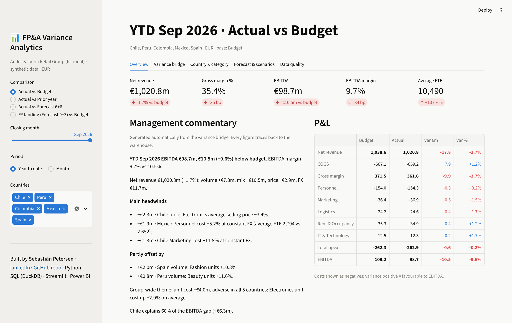
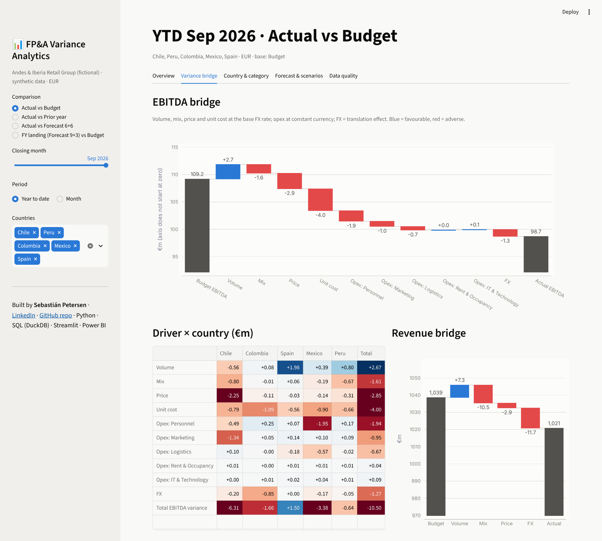
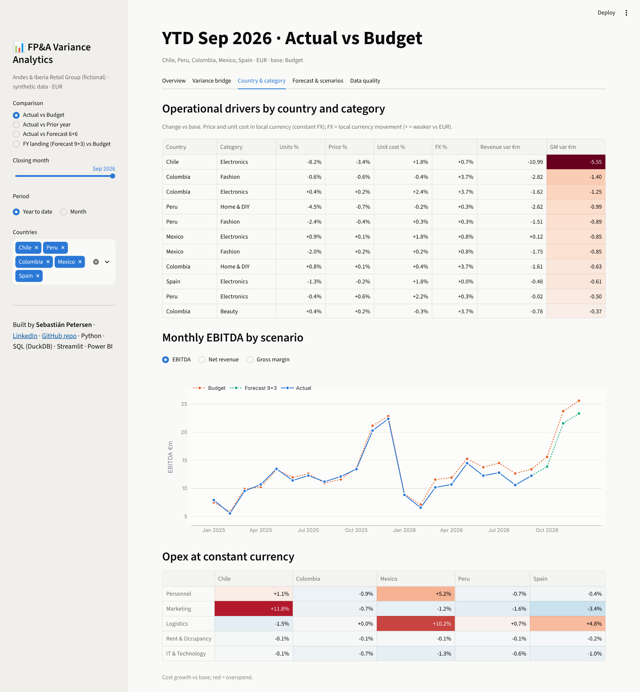
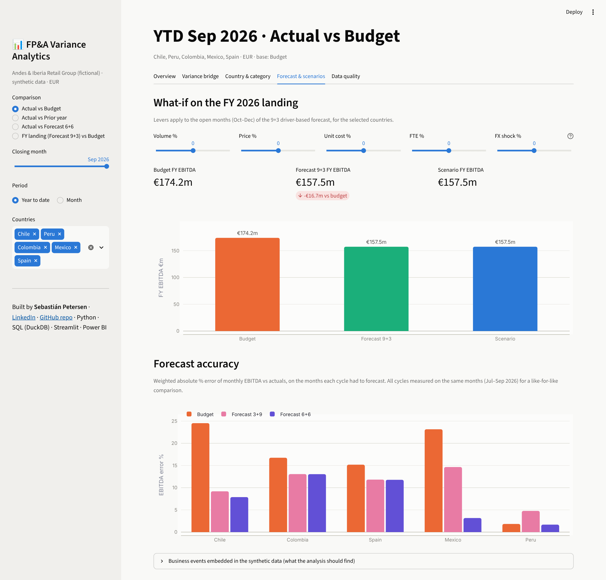
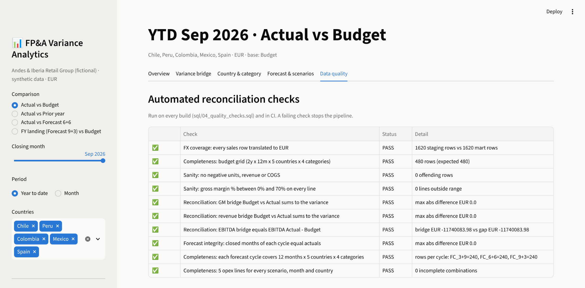

# FP&A Variance Analytics

**Budget vs. actual vs. forecast for a multi-country retail group: price / volume / mix / FX variance bridges, a driver-based rolling forecast, automated management commentary and reconciliation checks.**

[](https://github.com/speterseng-hub/fpa-variance-analytics/actions/workflows/ci.yml)


**[▶ Open the live dashboard]({{APP_URL}})**: no installation needed.



---

## The business question

> *"We are €10.5m below budget on EBITDA year to date. Why, where, and where will we land at year end?"*

Every month, an FP&A team has to answer this for the CFO within a few days of the close.
This project automates the full cycle on a fictional retail group (5 countries, 4 categories,
5 currencies, ~€1.5bn revenue):

1. **Consolidate** local-currency actuals, budget and forecasts and translate them to EUR.
2. **Explain** the variance with a bridge that splits it into volume, mix, price, unit cost,
   opex at constant currency and FX translation, by country and category.
3. **Forecast** the year-end landing with a driver-based rolling forecast (3+9, 6+6, 9+3) and
   test what-if scenarios.
4. **Write** the management commentary automatically from the numbers.
5. **Reconcile** everything with automated checks that stop the pipeline if numbers don't tie.

## Key findings (YTD September 2026 vs budget)

| | |
|---|---|
| **EBITDA** | €98.7m, **−€10.5m (−9.6%)** vs budget; margin 9.7% vs 10.5% |
| **Chile explains 60% of the gap** | A new online competitor in Electronics: units −8%, promotional prices −3%, and +12% marketing spend to defend share |
| **Mexico personnel** | +5% FTE (unbudgeted hires for a new distribution centre): −€1.9m |
| **Group-wide unit cost** | Electronics supplier costs +2% in every country: −€4.0m |
| **FX** | Weaker Latin American currencies (Colombian peso ~4% below the budget rate): −€11.7m on revenue, −€1.3m on EBITDA |
| **Offsets** | Strong Fashion season in Spain (+11% units, +€2.0m) and Beauty growth in Peru (+€0.8m) |
| **FY landing (9+3)** | €157.5m EBITDA, **−€16.7m vs budget**; the 6+6 forecast cut the budget's EBITDA error in Mexico from 23% to 3% |

> The data is synthetic. The business events above were deliberately embedded in the generator
> ([`business_events.csv`](data/raw/business_events.csv)), and the tests check that the analysis finds them.

## What's inside

| Layer | What it does | Files |
|---|---|---|
| **Data generation** | Reproducible ERP/EPM-style extracts in local currency: sales, opex, headcount, FX | [`src/generate_data.py`](src/generate_data.py) |
| **Forecast engine** | Driver-based rolling forecast: run-rate indices on the last 3 closed months applied to budget drivers; management levers | [`src/forecast.py`](src/forecast.py) |
| **SQL warehouse** | Staging → EUR marts → P&L → variance bridge as DuckDB table macros | [`sql/`](sql) |
| **Variance bridge** | Price / volume / mix / unit cost / FX on gross margin, opex at constant FX; reconciles to the cent | [`sql/03_variance_bridge.sql`](sql/03_variance_bridge.sql) |
| **Commentary** | Rule-based, traceable CFO bullet points: headline, headwinds, offsets, group-wide themes | [`src/commentary.py`](src/commentary.py) |
| **Data quality** | 10 reconciliation checks: completeness, FX coverage, bridge = gap, forecasts don't restate actuals | [`sql/04_quality_checks.sql`](sql/04_quality_checks.sql) |
| **Dashboard** | Streamlit app: overview, bridges, drill-down, what-if, forecast accuracy, checks | [`app/streamlit_app.py`](app/streamlit_app.py) |
| **Power BI kit** | Star schema extracts, DAX measures, theme and build guide | [`powerbi/`](powerbi) |
| **Tests & CI** | 12 pytest tests + ruff on every push (GitHub Actions) | [`tests/`](tests), [`.github/workflows/ci.yml`](.github/workflows/ci.yml) |

## Variance methodology

For every country × category × month (U = units, P = price, C = unit cost in local currency,
fx = local currency per EUR; *b* = base, *a* = actual):

| Driver | Formula (EUR) | Reads as |
|---|---|---|
| Volume | (U<sub>a,total</sub> · mix<sub>b</sub> − U<sub>b</sub>) · (P<sub>b</sub> − C<sub>b</sub>) / fx<sub>b</sub> | More or fewer units at budget mix |
| Mix | (U<sub>a</sub> − U<sub>a,total</sub> · mix<sub>b</sub>) · (P<sub>b</sub> − C<sub>b</sub>) / fx<sub>b</sub> | Shift between high- and low-margin categories |
| Price | (P<sub>a</sub> − P<sub>b</sub>) · U<sub>a</sub> / fx<sub>b</sub> | Selling price at constant currency |
| Unit cost | −(C<sub>a</sub> − C<sub>b</sub>) · U<sub>a</sub> / fx<sub>b</sub> | Purchase cost at constant currency |
| Opex | −(Opex<sub>a</sub> − Opex<sub>b</sub>) / fx<sub>b</sub> | Cost overrun at constant currency |
| FX | Value<sub>a</sub> · (1/fx<sub>a</sub> − 1/fx<sub>b</sub>) | Translation to EUR |

The components add up exactly to the EBITDA variance. This is checked on every build and in the
tests for five different comparisons (vs budget, vs prior year, vs forecast, FY landing, single month).
More detail in [`docs/methodology.md`](docs/methodology.md).

## Screenshots

| Variance bridge | Country & category drill-down |
|---|---|
|  |  |
| **Forecast, what-if & accuracy** | **Automated reconciliation checks** |
|  |  |

## Run it locally

```bash
git clone https://github.com/speterseng-hub/fpa-variance-analytics.git
cd fpa-variance-analytics
python -m venv .venv && source .venv/bin/activate   # Windows: .venv\Scripts\activate
pip install -r requirements-dev.txt

python -m src.pipeline           # generate data, build forecasts and warehouse, run checks
pytest -q                        # 12 tests
streamlit run app/streamlit_app.py
```

The warehouse builds in a few seconds. All data is generated with a fixed seed, so results are reproducible.

## Project structure

```
├── app/streamlit_app.py        # dashboard
├── data/raw/                   # synthetic ERP/EPM extracts (local currency)
├── data/processed/             # forecast cycles + DuckDB warehouse (built)
├── docs/                       # methodology and screenshots
├── powerbi/                    # star schema CSVs, DAX measures, theme, build guide
├── sql/                        # staging, marts, variance bridge macros, quality checks
├── src/
│   ├── config.py               # business assumptions in one place
│   ├── generate_data.py        # synthetic data + embedded business events
│   ├── forecast.py             # driver-based rolling forecast + what-if levers
│   ├── variance.py             # query layer (KPIs, P&L, bridges, accuracy)
│   ├── commentary.py           # automated management commentary
│   └── pipeline.py             # end-to-end build
└── tests/
```

## Why this project

I spent 8+ years in FP&A and finance data roles. Most recently, at a retail group operating in
7 countries, I coordinated the budget, monthly forecast and close for ~USD 250m of corporate technology spend,
built the finance data warehouse in BigQuery and moved reporting to Power BI and Tableau.
This repository rebuilds that workflow end to end with public tools and synthetic data: the
variance logic, the forecast discipline and the reconciliation habits are the ones I used in practice.

**Sebastián Petersen** · Barcelona · [LinkedIn](https://www.linkedin.com/in/sipetersen)

## Roadmap

- [ ] Power BI `.pbix` published with screenshots
- [ ] Cash-flow and working capital (DSO/DPO/DIO) module
- [ ] Statistical baseline forecast (ETS) to benchmark the driver-based forecast
- [ ] LLM-assisted commentary on top of the rule-based facts

---
MIT License · Synthetic data only. No real company figures are used.
